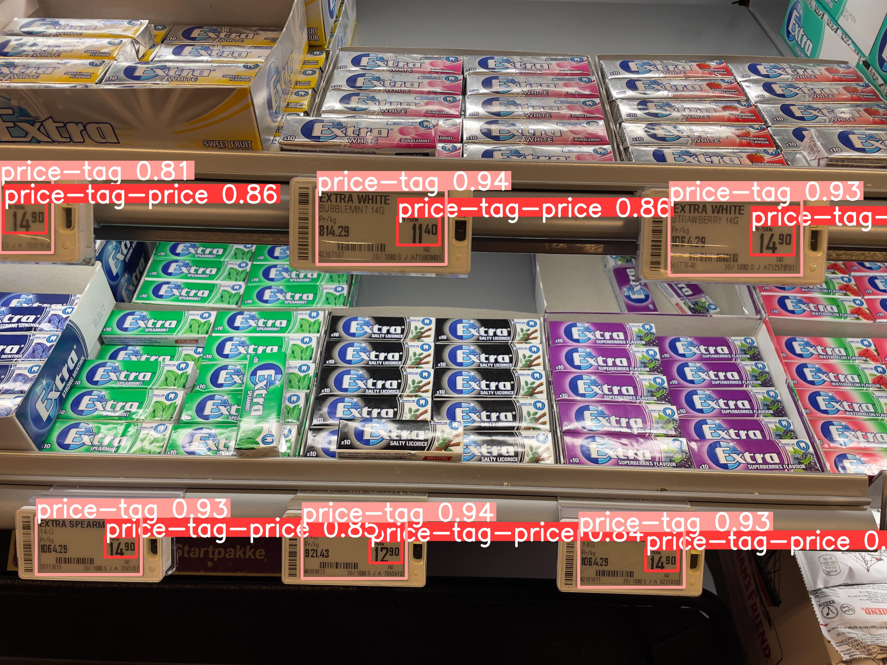

# Shop Price Tag

Detects shelf price tags in a camera frame, then reads the price, unit price
and barcodes from each tag. The detector runs inside the famn Flutter app via
[ultralytics_yolo](https://pub.dev/packages/ultralytics_yolo).



## Pipeline

```
camera frame
  └─ YOLO26n (on device, ultralytics_yolo)  → price tag boxes
       └─ crop each tag (+4 % padding)
            ├─ ML Kit text recognition       → text boxes → price parser → 22.80 kr / stk, 228 kr / kg
            └─ ML Kit barcode scanning       → every EAN/QR on the tag
```

Why this split:

- **YOLO stays the detector.** It is small enough for real-time camera use and
  exports straight to the TFLite and Core ML formats the Flutter plugin loads.
  Grounding DINO (~170M+ parameters, transformer text encoder) has no mobile
  export path and runs at seconds per frame even on a GPU.
- **Grounding DINO is used offline** to pre-label new photos
  (`scripts/autolabel.py`), so growing the dataset means correcting boxes
  instead of drawing them.
- **OCR and barcodes are not learned.** ML Kit's on-device text recogniser and
  barcode scanner already handle this well, return several codes per image,
  and need no training data. The part that needs custom logic is turning OCR
  text into a price, which is `shelftag/price_parser.py`.

## Layout

| Path | What |
| --- | --- |
| `scripts/train.py` | Fine-tune YOLO26n on the Roboflow dataset or a local `data.yaml` |
| `scripts/export.py` | Export to `.tflite` (Android) and `.mlpackage.zip` (iOS) for the plugin |
| `scripts/autolabel.py` | Grounding DINO pre-labelling of new photos into a YOLO dataset |
| `scripts/read_tags.py` | End-to-end reference run: detect, crop, OCR, parse, decode |
| `shelftag/price_parser.py` | OCR boxes → price, unit, comparison price, GTINs |
| `test/` | Shelf photos from Coop, NorgesGruppen and Rema |
| `*.ipynb` | Original notebooks (YOLOv8 / YOLO11 training, OCR experiments) |

## Usage

```sh
pip install -r requirements.txt

# Train (needs ROBOFLOW_API_KEY in .env)
python scripts/train.py --version 4

# Export for famn
python scripts/export.py runs/yolo26n-price-tag/weights/best.pt

# Try the full pipeline on the test photos
python scripts/read_tags.py test --weights models/best.pt --json results.json

# Pre-label new photos for the next dataset version
python scripts/autolabel.py photos/ --out datasets/autolabel --preview

pytest
```

## Price parsing rules

Norwegian tags print the price in the largest font, often with raised øre
(`22⁸⁰`), a unit next to it (`Pr/STK`, `Pr.KG`) and a smaller comparison price
(`228 pr KG`). The parser uses box geometry rather than text order:

- the tallest number on the tag is the price,
- a smaller two-digit number to its right with the same top edge is the øre,
- a four-digit tallest number with no øre found (`2280`) is split as `22.80`,
- `pr KG` / `pr L` / `pr STK` beside the price is its unit; with a number in
  front of it elsewhere it is the comparison price,
- 8/12/13/14-digit numbers with a valid GS1 check digit are reported as GTINs,
  as a fallback when the barcode itself can't be decoded.
